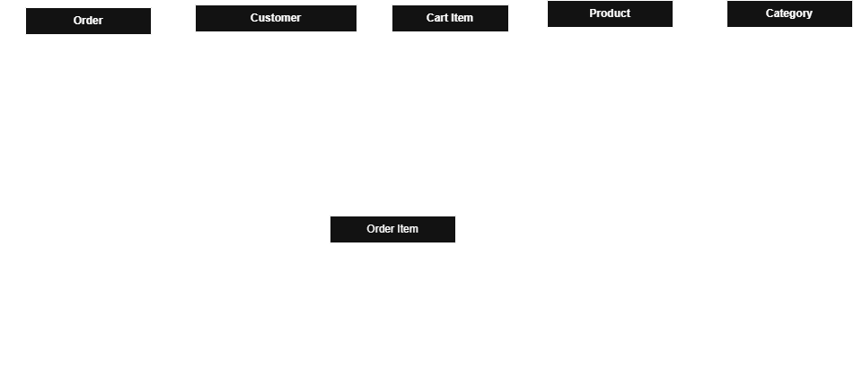

# FreshBasket - MAUI Offline Shopping App

An offline food-store app built with **.NET MAUI**, **MVVM** (CommunityToolkit.Mvvm) and **SQLite** (sqlite-net-pcl).
Everything runs locally: no server, no login.

## Entity Relationship Diagram




| Relationship | Cardinality |
|---|---|
| Category -> Product | 1 to 0..* |
| Customer -> Cart_item | 1 to 0..* |
| Product -> Cart_item | 1 to 0..* |
| Customer -> Order | 1 to 0..* |
| Order -> Order_item | 1 to 1..* (an order always has at least one line) |
| Product -> Order_item | 1 to 0..* |

The C# classes in `Models/` map one-to-one onto these tables (`[Table]` / `[Column]` attributes use the exact names
in the diagram). Foreign keys and the `UNIQUE (customer_id, product_id)` rule on `Cart_item` are enforced by SQLite itself (`PRAGMA foreign_keys = ON`).

### Why does Order_item store its own price instead of reading the product's current price?

`Product.price` is the **current** price and can change at any time (specials, inflation, corrections).
An order is a historical record of what the customer actually paid. If `Order_item` looked the price up from `Product`,
every old order would silently change whenever a price was edited, so past totals would no longer match
`Order.total`, receipts and reports would be wrong, and the same order would show different amounts on different days.
Copying the price into `Order_item.unit_price` at checkout freezes the price paid at that moment, so history stays
accurate no matter how the catalogue changes later.

## Product cards
The catalogue shows products as two-per-row cards (rounded card, soft shadow, gradient image area, status badge,
category label, name, description, price, stock and a round "+" button). The picture comes from `Product.image_path`:
put an image named exactly like the value (e.g. `classic_margherita_pizza.png`) in `Resources/Images/`; the extension is
not needed in the column. With no picture, an emoji for the dish or cuisine is shown instead. A badge shows "Only N left" at 5 or fewer, and "Sold out" at 0.

### Image file names
The card looks for an image whose name equals `Product.image_path` (extension optional). MAUI only accepts file names that
are **lowercase, start with a letter and contain only letters, digits and underscores**, so `Classic Margherita Pizza.jpg`
would not build. Expected files in `Resources/Images/`:

```
classic_margherita_pizza
vegetarian_stir_fry
chocolate_chip_cookies
chicken_alfredo_pasta
mango_salsa_chicken
quinoa_salad_with_avocado
tomato_basil_bruschetta
beef_and_broccoli_stir_fry
caprese_salad
shrimp_scampi_pasta
chicken_biryani
chicken_karahi
aloo_keema
chapli_kebabs
saag_spinach_with_makki_di_roti
japanese_ramen_soup
moroccan_chickpea_tagine
korean_bibimbap
greek_moussaka
butter_chicken_murgh_makhani
thai_green_curry
mango_lassi
italian_tiramisu
turkish_kebabs
blueberry_banana_smoothie
mexican_street_corn_elote
russian_borscht
south_indian_masala_dosa
lebanese_falafel_wrap
brazilian_caipirinha
```
(each with .png / .jpg / .jpeg). If a file is missing or misnamed, that card shows its emoji instead of a picture.

## Architecture (MVVM)

```
Models/        Plain data classes (tables) + read-only projections (ProductListItem, CartLine, OrderSummary)
Services/      StoreService (all SQLite code), session, navigation and dialog services - all behind interfaces
ViewModels/    BaseViewModel + one view model per screen (no UI types, no code-behind logic)
Views/         XAML pages; code-behind only sets BindingContext and triggers Load on OnAppearing
```

| Screen | View | ViewModel |
|---|---|---|
| Select Customer | `CustomerSelectPage` | `CustomerSelectViewModel` |
| Product Catalogue | `CataloguePage` | `CatalogueViewModel` |
| Product Details + Add to Cart | `ProductDetailsPage` | `ProductDetailsViewModel` |
| Cart + Checkout | `CartPage` | `CartViewModel` |
| Order History | `OrderHistoryPage` | `OrderHistoryViewModel` |

Navigation is Shell-based; services, view models and pages are wired up with dependency injection in `MauiProgram.cs`.

### How the database is set up
`Resources/Raw/OfflineShoppingApp.db` is bundled with the app and copied to the app data folder on first launch, **and again
whenever a different database file is bundled** (detected by hash), so replacing the .db in the project takes effect on the
next run without uninstalling the app. Orders placed inside the app are kept until the bundled file itself changes.
`StoreService` creates any missing tables (`Category`, `Product`, `Cart_item`, `Order`, `Order_item`) and seeds sample
customers only if the Customer table is empty (and sample categories/products only if both are empty).

### Order history
"Order history" on the catalogue opens the selected customer's past orders, newest first. Each card shows the order number,
date, total, item count and every line with the quantity and the **price paid at the time** (`Order_item.unit_price`),
so old orders never change when product prices do. A new order appears there straight after checkout.

### Business rules
* **Add to cart** - quantity must be a whole number > 0; `quantity + already in cart <= stock`. Adding a product
  that is already in the cart increases that row's quantity instead of creating a new line.
  Checked in the view model (instant feedback) **and** again inside a DB transaction.
* **Checkout** - disabled / refused for an empty cart. In **one transaction**: create `Order`, copy each `Cart_item`
  into an `Order_item` (with the price paid), reduce each product's stock, delete the cart rows. Any failure rolls
  everything back. Then a confirmation is shown and the catalogue refreshes its stock and cart count.

## Setup

1. Open `ShoppingAppSln.slnx` in Visual Studio 2022/2026 with the .NET MAUI workload (targets .NET 10).
2. Packages used (already in `ShoppingApp.csproj`): `CommunityToolkit.Mvvm`, `sqlite-net-pcl`.
   If you ever see a "SQLitePCLRaw provider" error at runtime, also add `SQLitePCLRaw.bundle_green`.
3. Make sure these files are present:
   * `Resources/Raw/OfflineShoppingApp.db` - the bundled database (`MauiAsset`)
   * `Resources/Images/*.png|jpg` - one picture per product, named like `Product.image_path`
4. Pick the Android emulator (or Windows Machine) and press F5.
   After changing the database file, **uninstall the app from the emulator** so the new copy is installed.

## Manual test checklist
- Search the customer list (e.g. "joseph") and pick a customer -> catalogue shows their name and "Items in cart: n".
- Product cards show the picture (or an emoji if the image file is missing), category, name, description, price and stock.
- Open *Shrimp Scampi Pasta* (stock 3): add 2, then try 2 more -> blocked ("Only 1 more can be added").
- *Turkish Kebabs* is sold out (stock 0) -> "Sorry, Turkish Kebabs is sold out."
- Quantity `0`, `-2`, `1.5`, `abc`, empty -> each rejected with a clear message.
- Add the same product twice -> cart shows one line with the combined quantity.
- Remove an item -> total updates. Empty cart -> Checkout disabled.
- Checkout -> confirmation, back on the **catalogue** (same scroll position) with reduced stock and cart count 0.
- Catalogue -> Order history shows that customer's orders (newest first); the order you just placed is at the top.
- Switch customer -> they have their own separate cart and history.
