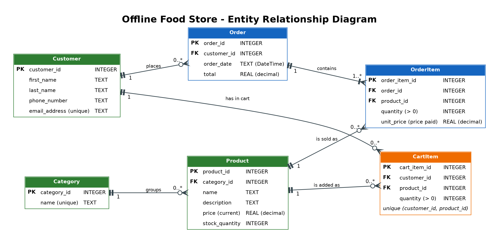

# FreshBasket - MAUI Offline Shopping App

An offline food-store app built with **.NET MAUI**, **MVVM** (CommunityToolkit.Mvvm) and **SQLite** (sqlite-net-pcl).
Everything runs locally: no server, no login.

## Entity Relationship Diagram



| Relationship | Cardinality |
|---|---|
| Category -> Product | 1 to 0..* |
| Customer -> CartItem | 1 to 0..* |
| Product -> CartItem | 1 to 0..* |
| Customer -> Order | 1 to 0..* |
| Order -> OrderItem | 1 to 1..* (an order always has at least one line) |
| Product -> OrderItem | 1 to 0..* |

The C# classes in `Models/` map one-to-one onto these tables (`[Table]` / `[Column]` attributes use the exact names
in the diagram). Foreign keys, `CHECK` constraints (e.g. `quantity > 0`, `stock_quantity >= 0`) and a
`UNIQUE (customer_id, product_id)` on `CartItem` are enforced by SQLite itself (`PRAGMA foreign_keys = ON`).

### Why does OrderItem store its own price instead of reading the product's current price?

`Product.price` is the **current** price and can change at any time (specials, inflation, corrections).
An order is a historical record of what the customer actually paid. If `OrderItem` looked the price up from `Product`,
every old order would silently change whenever a price was edited, so past totals would no longer match
`Order.total`, receipts and reports would be wrong, and the same order would show different amounts on different days.
Copying the price into `OrderItem.unit_price` at checkout freezes the price paid at that moment, so history stays
accurate no matter how the catalogue changes later.

## Architecture (MVVM)

```
Models/        Plain data classes (tables) + two read-only projections (ProductListItem, CartLine)
Services/      StoreService (all SQLite code), session, navigation and dialog services - all behind interfaces
ViewModels/    BaseViewModel + one view model per screen (no UI types, no code-behind logic)
Views/         XAML pages; code-behind only sets BindingContext and triggers Load on OnAppearing
```

| Screen | View | ViewModel |
|---|---|---|
| Select Customer | `CustomerSelectPage` | `CustomerSelectViewModel` |
| Product Catalogue | `CataloguePage` | `CatalogueViewModel` |
| Product Details + Add to Cart | `ProductDetailsPage` | `ProductDetailsViewModel` |
| Cart + Checkout | `CartPage` | `CartViewModel` |

Navigation is Shell-based; services, view models and pages are wired up with dependency injection in `MauiProgram.cs`.

### How the database is set up
`Resources/Raw/ShoppingApps.db` (the provided file) is bundled with the app and copied to the app data folder on first
launch. `StoreService` then creates any missing tables (`Category`, `Product`, `CartItem`, `Order`, `OrderItem`) and seeds
sample customers, 7 food categories and 23 products if they are empty. To reset: uninstall the app / clear its data.

### Business rules
* **Add to cart** - quantity must be a whole number > 0; `quantity + already in cart <= stock`. Adding a product
  that is already in the cart increases that row's quantity instead of creating a new line.
  Checked in the view model (instant feedback) **and** again inside a DB transaction.
* **Checkout** - disabled / refused for an empty cart. In **one transaction**: create `Order`, copy each `CartItem`
  into an `OrderItem` (with the price paid), reduce each product's stock, delete the cart rows. Any failure rolls
  everything back. Then a confirmation is shown and the catalogue refreshes its stock and cart count.

## Setup

1. Create the project (name it **ShoppingApp** so namespaces match):
   ```
   dotnet new maui -n ShoppingApp
   ```
2. Add packages:
   ```
   dotnet add package CommunityToolkit.Mvvm
   dotnet add package sqlite-net-pcl
   dotnet add package SQLitePCLRaw.bundle_green
   ```
3. Copy this repo's files over the new project (replace `App.xaml`, `App.xaml.cs`, `AppShell.xaml`,
   `AppShell.xaml.cs`, `MauiProgram.cs`; delete the template's `MainPage.xaml` / `MainPage.xaml.cs`).
   `Resources/Raw/ShoppingApps.db` is picked up automatically as a `MauiAsset`.
4. Run on Android emulator / Windows (`dotnet build -t:Run -f net8.0-android`, or press F5 in Visual Studio).

> On .NET 10, `Page.DisplayAlert` is marked obsolete in favour of `DisplayAlertAsync`. It still works; swap the one line in
> `Services/IDialogService.cs` if you want the warning gone.

## Manual test checklist
- Pick a customer -> catalogue shows their name and "Items in cart: 0".
- Open *Avocados* (stock 5): add 3, then try 3 more -> blocked ("Only 2 more can be added").
- Quantity `0`, `-2`, `1.5`, `abc`, empty -> each rejected with a clear message.
- *Beef Mince* has stock 0 -> cannot be added.
- Add the same product twice -> cart shows one line with the combined quantity.
- Remove an item -> total updates. Empty cart -> Checkout disabled.
- Checkout -> confirmation, back on catalogue with reduced stock and cart count 0.
- Switch customer -> they have their own separate cart.
